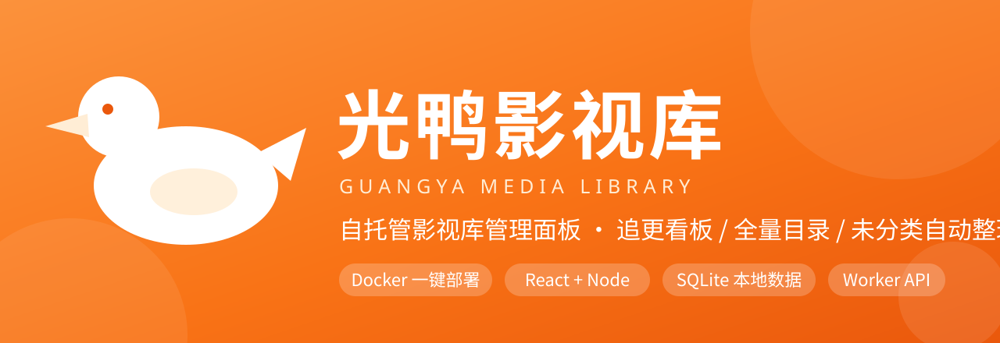
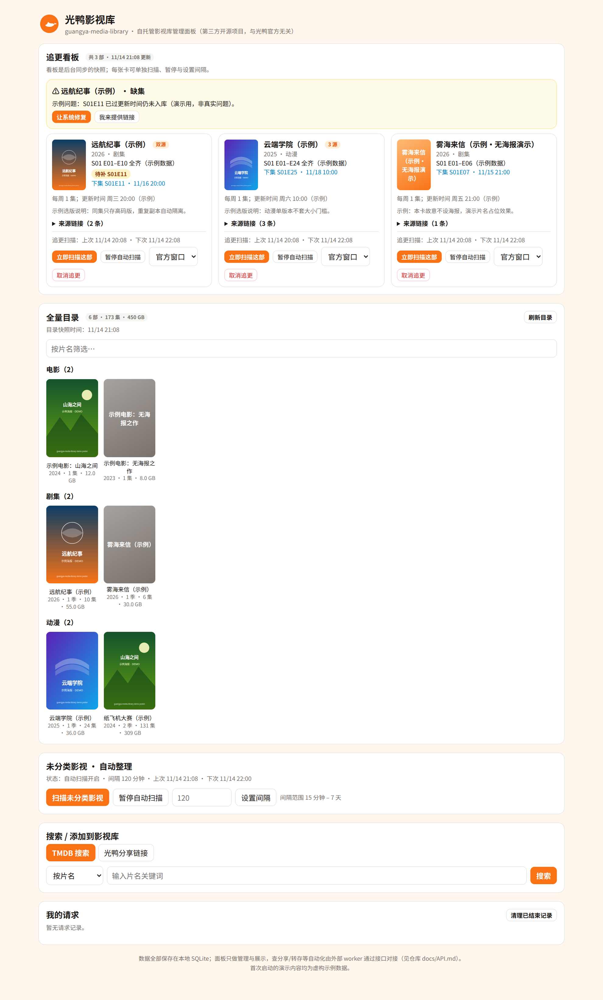
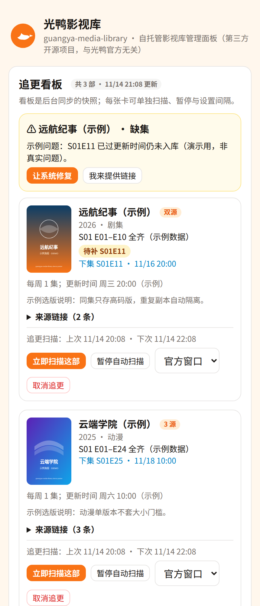

<p align="center">
  
</p>

<p align="center">
  <a href="LICENSE"></a>
  
  
  
  
</p>

<p align="center">
  <b>一个自托管的光鸭云盘影视库管理面板</b>：追更看板、全量目录海报墙、未分类影视自动整理、TMDB 搜索与分享链接提交、请求队列。<br>
  面板只负责管理与展示；查分享、转存等真实自动化由外部 <b>worker</b> 通过带令牌的接口对接（仓库自带示例 worker）。
</p>

> **项目定位：** 本项目不依赖任何 AI 智能体即可独立运行全套日常自动化（轮询、验源、转存、改名、转移、排重、选版、刷新）；智能体只是可选增强，用于搜新源、失效换源这类需要判断的场景。

> **English summary:** A self-hosted web panel for managing a Guangya （光鸭云盘） media library: a watch board for tracked shows, a full-library poster catalog, an unclassified-folder auto-scan panel, TMDB search & share-link submission, and a request queue. State lives in a local SQLite file; the actual cloud-drive automation runs in an external "worker" that talks to a token-protected API (an example worker is included). Unofficial third-party project, not affiliated with Guangya. Demo seed data is entirely fictional.

---

## 📸 界面预览

<p align="center">
  
  <br><i>追更看板（逐部独立扫描控制、多来源徽标、问题卡）与全量目录海报墙</i>
</p>

<table align="center">
  <tr>
    <td align="center" width="62%">
      
      <br><i>全页总览：看板 / 目录 / 未分类面板 / 搜索添加 / 我的请求</i>
    </td>
    <td align="center" width="38%">
      
      <br><i>移动端同样可用</i>
    </td>
  </tr>
</table>

> 以上截图均为首次启动时的**虚构示例数据**，接入你自己的 worker 同步真实数据后即被替换。

## ✨ 功能亮点

- **追更看板**：每部在追的作品一张卡——海报、库内进度、待补集数、下集时间、来源链接（条数不限，2 条显示「双源」、≥3 条显示「N 源」）、链接管理、逐部独立的扫描控制（立即扫描这部 / 暂停恢复 / 自定义间隔 / 实时进度条）、取消追更；顶部有全局扫描进度条；缺集、分享失效等问题卡带「提交修复请求 / 我来提供链接」（修复请求只是排队，由你接入的 worker 领取执行，面板本身不操作网盘，详见下方常见问题第一条）。
- **自主追更轮询**：真实 worker 骨架内置定时轮询（默认 30 分钟一轮，可调可关）：到更新时间自动查来源、验源、补缺集、按模板改名、同集排重、回写看板并联动 Drivemby 刷新——全是确定性活，全自动运行，不依赖任何 AI 智能体。
- **选版设置（面板里自己定）**：同一集存哪个版本由使用者在面板抉择——模式二选一（只存最优版 / 先到先存、发现更优自动替换），评分依据可排序（分辨率 / 画质（HDR·杜比视界）/ 文件大小），文件大小可偏好越大或越小；保存即生效，worker 每轮自动读取。
- **全量目录**：整个影视库的海报墙（电影 / 剧集 / 动漫分组），分批加载、海报懒加载、片名筛选、总量统计，一键提交目录刷新。
- **未分类影视面板**：自动整理扫描的开关、自定义间隔（15 分钟–7 天）、本次/上次/下次扫描时间、手动扫描与实时进度。
- **搜索 / 添加**：TMDB 按片名或 ID 搜索（结果 5 分钟内有效，勾选提交后定稿）；光鸭分享链接提交（**链接格式会被严格校验，不完整的链接当场报错，不会静默失败**）。
- **我的请求**：全部请求与状态、进度、结果说明；可取消、删除、一键清理已结束记录；失败记录可一键转「提供链接」。
- **数据全在本地**：所有状态只存一个 SQLite 文件，不上传任何服务器；仓库不含任何真实链接、账号或令牌。

---

## 🚀 部署教程（小白友好版）

推荐用 **Docker** 部署：不需要会编程、不需要装 Node，跟着复制粘贴命令就能跑起来。整个过程大约 5–10 分钟。

### 第 0 步：安装 Docker

面板运行在 Docker 里，先确认你的机器装好了它：

- **Windows / macOS**：到 [Docker Desktop 官网](https://www.docker.com/products/docker-desktop/)下载安装，一路下一步；装完**打开 Docker Desktop**，等它完全启动（Windows 第一次可能会提示安装 WSL2，跟着向导走即可）。
- **Linux 服务器**：运行官方一键脚本 `curl -fsSL https://get.docker.com | sh`，再运行 `sudo systemctl enable --now docker` 让它开机自启。
- **群晖 / 威联通 NAS**：在套件中心装好 Container Manager / Container Station，后面第 3 步可以用它的「项目 / Compose」功能加载本仓库的 `docker-compose.yml`，效果一样。

验证一下（打开终端 / 命令行窗口，输入下面两行，能显示版本号就是装好了）：

```bash
docker --version
docker compose version
```

### 第 1 步：下载本项目

```bash
git clone https://github.com/your98k/guangya-media-library.git
cd guangya-media-library
```

> 没有装 git？点仓库页面右上角绿色的 **Code → Download ZIP**，下载后解压，再用终端进入解压出来的文件夹，效果一样。

### 第 2 步：改一下配置（重要，只改一处）

```bash
cp .env.example .env
```

用记事本（或任何文本编辑器）打开刚生成的 `.env` 文件，把这一行改掉：

```
WORKER_TOKEN=换成你自己想的一串字符
```

- `WORKER_TOKEN` 是**面板和自动化程序（worker）之间的暗号**：以后你的 worker 来对接时要报这个暗号，两边填一样即可。随便想一串长一点的字符就行，**不要用默认的 `change-me`**。
- 同一个文件里的 `PORT=8080` 是面板的访问端口。如果 8080 被别的程序占用了，改成别的数字（比如 `8091`），后面访问时用新端口。

### 第 3 步：启动

```bash
docker compose up -d
```

- 第一次运行会先**构建镜像**（下载基础镜像＋打包前后端），需要几分钟，属正常现象；之后再启动就是秒开。
- `-d` 表示在后台运行，关掉终端窗口也不会停。
- 这条命令会**同时启动两个容器**：面板和负责干活的 worker（定时轮询、转存、改名这些自动化都是它在跑），不需要再单独部署 worker。worker 的账号类配置还没填时它只会待命，并在日志里列出缺什么，不影响面板使用。

确认它真的跑起来了：

```bash
docker compose ps       # 状态是 running / Up 就对了
docker compose logs -f  # 看实时日志；按 Ctrl+C 只是退出看日志，不会停服务
```

### 第 4 步：打开面板 🎉

浏览器打开 **http://localhost:8080**（第 2 步改过端口的话用新端口）。

- 在**同一台机器**上装的，用 `localhost`；想在手机或另一台电脑上打开，把 `localhost` 换成这台机器的局域网 IP，例如 `http://192.168.1.10:8080`。
- 第一次打开看到的是几部「示例」剧目和示例数据，**这是正常的**——那是给你看界面长什么样的演示内容；worker 配好你的账号、同步真实数据后会被替换掉。

### 常用运维小抄

| 想做什么 | 命令 |
| --- | --- |
| 停止面板 | `docker compose down`（只是停容器，**数据不会丢**） |
| 再次启动 | `docker compose up -d` |
| 重启 | `docker compose restart` |
| 看日志排查问题 | `docker compose logs -f` |
| 更新到最新版 | `git pull` 然后 `docker compose up -d --build` |
| 改了 `.env`（如换端口/令牌） | `docker compose up -d` 重新创建即可生效 |

### 数据存在哪、怎么备份

- 全部数据只在一个文件里：项目目录下的 **`data/app.db`**（SQLite 数据库），容器里的 `/app/data` 就是它。
- **备份** = 把 `data` 文件夹复制一份存好（建议先 `docker compose down` 再复制，最稳妥）。
- **搬家** = 新机器上装好项目后，把旧的 `data` 文件夹拷过去覆盖，再 `docker compose up -d`，一切照旧。
- **恢复出厂** = 停服后删掉 `data` 文件夹再启动，会重新生成示例数据（注意：这会清空你现有的数据）。

### 方式二：不用 Docker（源码运行）

适合想改代码或调试的人。需要先装 [Node.js 20+](https://nodejs.org/)（官网下载 LTS 版安装即可）：

```bash
npm run install:all   # 安装后端与前端依赖
npm run build         # 构建前端
npm start             # 启动（默认 8080 端口）
```

打开 http://localhost:8080 即可。开发模式（改代码热更新）用 `npm run dev`：后端在 8080、前端在 5173。

### 接入自动化 worker（可选，进阶）

面板本身**不直接操作网盘**。真正干活的（查分享、转存、刷新目录等）是外部 worker，它通过接口和面板配合：轮询领取面板里的请求 → 干活 → 把结果和最新看板/目录推回面板。完整接口见 [docs/API.md](docs/API.md)。

先跑仓库自带的**示例 worker** 看看效果（它只做演示：搜索请求可选走真实 TMDB，其余请求模拟完成）：

```bash
# 在项目目录下，WORKER_TOKEN 必须和 .env 里填的一致
WORKER_TOKEN=你在.env里填的暗号 API_BASE=http://localhost:8080 npm run worker
```

- 想让示例 worker 的搜索走**真实 TMDB**：去 [TMDB 官网](https://www.themoviedb.org/)注册后在设置里申请一个 API Key，启动时多带一个变量：`TMDB_API_KEY=你的key WORKER_TOKEN=你的暗号 API_BASE=http://localhost:8080 npm run worker`。
- 写你自己的 worker 时，只需照着 [docs/API.md](docs/API.md) 请求这些接口，并在请求头带上 `Authorization: Bearer <WORKER_TOKEN>`。

仓库另附一个**真实 worker 骨架**（[`worker/real/`](worker/real/README.md)），与上面的示例 worker（只模拟演示）不同：它内置**自主追更轮询**，自己定时查已登记的来源、验源、补缺集、改名、排重、刷新看板——日常自动化全自动，不依赖任何 AI 智能体；选版按面板「选版设置」执行（模式＋依据排序，保存即生效；环境变量 `VERSION_POLICY` 只在面板从未保存过设置时作回退默认）。只有去教父网 / 迷你影视**搜新源、失效换源**这类需要判断的活不能保证全自动（受站点登录墙/验证码影响，骨架会尝试并如实回写）。使用它需要部署者自备各站登录 Cookie、光鸭登录态与 TMDB key；**默认 dry-run**，只检索验源并把候选报告写回请求，不动网盘；配置齐全并开启 `GUANGYA_INGEST=on` 后才真转存，真转存成功后还可联动 Drivemby 刷新入库目录。它已包含在仓库的 compose 里，跟面板同一条 `docker compose up -d` 一起自动部署，不需要单独启用（注意别再同时单独运行示例 worker，两者会抢同一批请求）；环境变量与诚实边界见其 [README](worker/real/README.md)。

### 常见问题

- **点了「提交修复请求」后，问题会自动修好吗？** 要分两类活看：①**日常自动化**——追更轮询、验源、转存、改名、转移文件夹、排重、选版、看板/目录刷新、Drivemby 刷新，这些是确定性活，真实 worker 骨架全自动完成，**不需要任何 AI 智能体**；②**修复请求指向的活**——去聚合站**搜新源**、给失效分享**换源**，这类需要判断、又受站点登录墙 / 验证码 / 改版影响，**不能保证全自动**：面板只是把请求记进队列，示例 worker 只演示流程、不会真的去找；真实 worker 骨架会尝试检索与换源，成败都会如实写回请求说明。没有 worker 在运行时，提交的请求会一直停在「等待处理」，这是正常现象，不是卡住了。
- **打开 http://localhost:8080 没反应？** 先运行 `docker compose ps` 看容器是否在运行；不在就 `docker compose logs` 看报错。Windows/macOS 还要确认 Docker Desktop 已经完全启动。
- **提示端口被占用（port is already allocated）？** 把 `.env` 里的 `PORT` 改成别的数字（如 `8091`），再 `docker compose up -d`，访问时用新端口。
- **构建/拉取镜像特别慢？** 多半是网络问题：国内网络可以给 Docker 配置镜像加速（Docker Desktop → Settings → Docker Engine 里添加 `registry-mirrors`，镜像源地址搜「Docker 镜像加速」按当下可用的填），保存重启 Docker 后再试。
- **面板没有登录密码，安全吗？** 是的，面板的页面接口默认无鉴权，**请只在内网使用**，不要直接暴露到公网；确需公网访问，请套一层带鉴权的反向代理（如 Nginx Basic Auth、Cloudflare Access）。
- **示例数据怎么去掉？** 接入你的 worker 同步真实数据后自动覆盖；或者按上面「恢复出厂」清空重来（会清掉现有数据，慎用）。

---

## 🔌 Worker 接口速览

自动化与面板之间只有一层 REST 接口（完整文档见 [docs/API.md](docs/API.md)）：

- worker 轮询 `GET /api/worker/requests/pending` 领取请求，用 `POST /api/worker/requests/:id` 回写进度与结果；
- worker 把追更看板、全量目录、来源链接、问题列表、扫描时钟以快照/合并方式推回面板（`/api/worker/board`、`/api/worker/catalog`、`/api/worker/watch-links` 等）；
- 全部 worker 接口需要请求头 `Authorization: Bearer <WORKER_TOKEN>`。

`worker/example-worker.mjs` 是一个零依赖示例：搜索请求在配置 `TMDB_API_KEY` 时走真实 TMDB，否则返回明确标注的演示结果；其余请求模拟完成并在结果说明里写清真实实现应做什么。**真正的光鸭自动化就接在这个位置**：领取请求 → 操作网盘 → 回写结果与快照。

## 🗂 项目结构

```
client/            React + Vite + TypeScript 前端（追更看板 / 目录 / 未分类 / 搜索 / 我的请求）
server/            Express + better-sqlite3 后端（UI 接口 + Worker 接口 + SQLite）
worker/            示例 worker（零依赖 Node 脚本）
docs/              接口文档（API.md）与 README 图片（images/）
Dockerfile         多阶段构建：构建前端 → Node 20 生产镜像（非 root 运行）
docker-compose.yml 一键部署（数据卷 ./data、端口、WORKER_TOKEN、时区）
```

## 🔒 数据与隐私

- 本项目**不包含任何真实分享链接、账号、令牌或个人数据**；仓库里的演示内容全部为虚构示例。
- 运行数据全部保存在本地 `data/app.db`（SQLite），不上传任何服务器。
- UI 接口默认无鉴权：请勿把面板直接暴露到公网，建议放在内网或反向代理（含鉴权）之后。

## ⚠️ 与光鸭的关系

本项目是**非官方的第三方开源项目**，与光鸭云盘官方无关；「光鸭」名称仅用于说明用途。项目只提供管理面板与接口，不包含任何网盘账号功能本身，使用者需自行实现/接入自己有权使用的自动化。请遵守相关服务条款与法律法规。

## 📄 License

[MIT](LICENSE)
